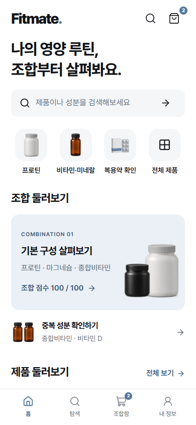
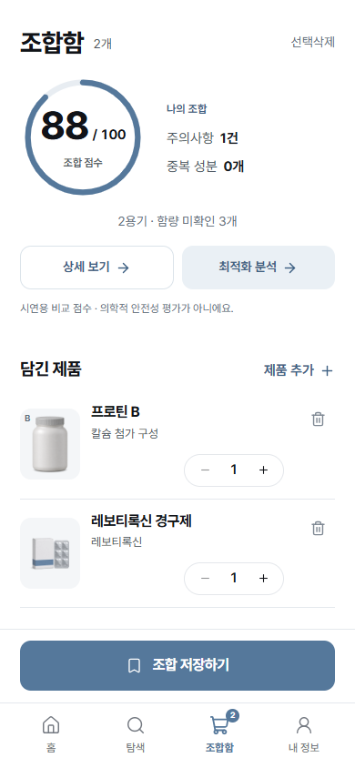
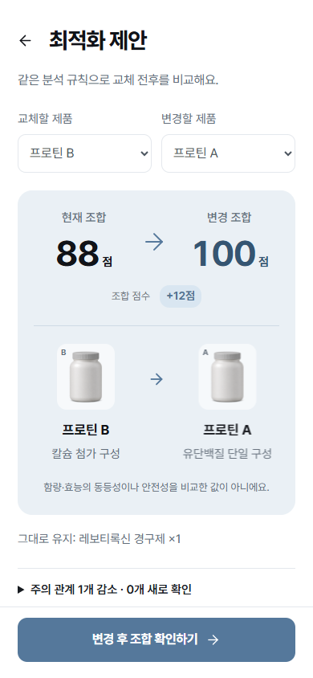

# FITMATE

**함께 먹는 보충제·영양제의 성분 관계를 확인하고, 제품 교체 전후를 비교하는 모바일 우선 웹 앱입니다.**

제품 탐색 → 조합함에 담기 → 분석 근거 확인 → 교체 비교 → 내 조합 저장

<p>
  
  
  
</p>

현재 코드를 로컬에서 실행한 실제 화면입니다. 가상 제품 데이터와 시연용 비교 점수를 사용하며, **100점도 의학적 안전성을 보장하지 않습니다.** 실제 섭취량·복용 시간·개인 상태에 대한 의학적 판단은 제공하지 않습니다.

## 핵심 기능

- **제품 탐색과 조합 구성** — 제품·성분 검색, 카테고리 필터, 별도의 복용약 탐색, 담기·취소·수량 변경.
- **근거를 확인하는 분석** — 등록된 성분 ID로 제품 쌍을 비교하고, 관련 규칙·출처·감점 계산과 정보 부족을 함께 표시.
- **제품 교체 전후 비교** — 같은 분석 엔진으로 기존 구성과 후보 구성을 계산하고, 사라진 주의 관계와 새로 생긴 관계를 구분.
- **내 조합 저장·복원** — localStorage에 제품 구성을 저장하고 새로고침·불러오기 시 현재 데이터로 다시 분석.

예를 들어 P02(프로틴 B)+M02(레보티록신 경구제)는 R06에 따라 88점으로 표시됩니다. P02를 P01(프로틴 A)로 교체하면 같은 엔진이 100점으로 계산합니다. 이는 등록된 성분 관계의 차이이며 안전성 개선의 보장이 아닙니다.

## 프로젝트와 기여 범위

해커톤에서 출발한 프로젝트입니다. 팀의 아이디어 기획·발표 활동과 현재 웹 서비스 개발 범위를 구분합니다.

| 구분 | 범위 |
| --- | --- |
| 해커톤 팀 | 서비스 아이디어 기획 및 발표 |
| 개인 개발 | 현재 웹 서비스 코드 단독 개발: React 화면·상태 관리, JSON 분석 엔진, 교체 비교, 저장·복원, 인터랙션 및 테스트 |

기획 문서는 [PRD](docs/PRD.md), 실제 지원 범위는 [분석 엔진 문서](docs/ANALYSIS_ENGINE.md)에 정리했습니다. 기획에 포함된 모든 기능이 구현된 것은 아닙니다.

## 기술 선택

| 선택 | 구현에서의 역할과 이유 |
| --- | --- |
| React + TypeScript + Vite | 화면과 분석 도메인을 분리하고, 제품·성분·분석 결과를 명시적 타입으로 연결했습니다. 현재 시연 범위는 정적 웹 앱으로 실행합니다. |
| 로컬 JSON + 순수 분석 함수 | 네트워크 요청 없이 같은 입력을 같은 규칙으로 분석하고, UI와 분리해 경계 조건을 단위 테스트할 수 있도록 구성했습니다. |
| localStorage | 별도 계정·서버 없이 시연 중 조합을 유지합니다. 읽은 데이터는 정규화하고, 쓰기 실패는 사용자에게 알립니다. |
| Motion for React | 화면 전환·제품 선택·점수 변화에 모션을 적용하고 `prefers-reduced-motion` 설정을 반영합니다. |
| Vitest + Playwright | 엔진의 계산·예외 조건과 브라우저에서의 검색·교체·저장·제스처를 나눠 검증합니다. |

## 데이터 흐름과 구조

```text
제품 선택 → App의 cart 상태 → analyzeCart(cart, analysisDataset)
                                  ↑                 ↓
                         원본 JSON → data.ts    AnalysisResult
                                                    ↓
                                  조합 점수·규칙·출처·미확인 정보 표시

제품 교체 후보 → 동일 analyzeCart로 전후 비교 → 확정 시 cart 갱신
조합 저장 → 제품 ID·용기 수량을 localStorage에 보관 → 복원 시 재계산
```

- [`src/App.tsx`](src/App.tsx): 해시 기반 6개 화면 전환과 조합·저장 상태 연결. 결과·최적화·보관함은 지연 로딩합니다.
- [`src/analysis/`](src/analysis/): 데이터 어댑터, 조건 평가, 성분 관계 분석, 점수 정책, 교체 비교. React와 저장소에 의존하지 않는 계산 영역입니다.
- [`src/lib/`](src/lib/): 카탈로그·이미지 매핑과 저장 데이터 검증.
- [`src/screens/`](src/screens/), [`src/components/`](src/components/): 화면과 공통 UI. 원본 데이터는 [`src/data/`](src/data/)에 유지합니다.

## 기술적 문제와 구현

### 1. 제품이 늘어날 때 같은 원인이 중복 감점되는 문제

표시용 관계는 `규칙 ID + 정렬한 제품 쌍`으로 구분하고, 점수 계산은 정렬한 성분 쌍인 `causeKey`로 묶었습니다. 같은 원인이 여러 제품에서 발견돼도 가장 큰 감점 한 번만 반영하면서, 근거의 규칙과 제품 쌍은 남깁니다.

구현: [engine.ts](src/analysis/engine.ts), [scoring.ts](src/analysis/scoring.ts) · 검증: [engine.test.ts](src/analysis/__tests__/engine.test.ts)

### 2. 모르는 데이터를 정상 판정으로 오해하는 문제

함량 `null`을 0으로 바꾸지 않고, 조건 평가를 `met / not_met / unknown / unsupported`로 구분합니다. 평가할 성분 쌍이 없거나 관련 필수 규칙을 지원하지 않으면 숫자 점수를 보류합니다. 제품 정보가 부족한 교체 후보도 개선안으로 제시하지 않습니다.

구현: [conditions.ts](src/analysis/conditions.ts), [engine.ts](src/analysis/engine.ts), [optimization.ts](src/analysis/optimization.ts) · 정책과 한계: [SCORING_POLICY.md](docs/SCORING_POLICY.md)

### 3. 모바일 스크롤이 제품 선택으로 이어지는 문제

카탈로그 버튼에서 포인터 이동 거리를 추적해 드래그 뒤 발생하는 클릭을 억제하고, 키보드로 발생한 클릭은 유지합니다. 상세 시트는 네이티브 `dialog`를 사용해 배경 접근을 막고, 닫을 때 이전 포커스와 스크롤 설정을 복원합니다.

구현: [BrowseButton.tsx](src/components/BrowseButton.tsx), [Sheet.tsx](src/components/Sheet.tsx) · 검증: [release-smoke.spec.ts](tests/release-smoke.spec.ts)

## 실행과 검증

검증 환경: **Node.js 24.18.0 / npm 11.16.0 / Windows / Google Chrome**. 저장소를 내려받은 뒤 프로젝트 루트에서 실행합니다.

```sh
npm ci
npm run dev -- --host 127.0.0.1
```

기본 주소는 http://127.0.0.1:5173 입니다. 현재 앱 실행에는 API 키나 별도 서버 설정이 필요하지 않습니다. 브라우저 테스트는 설치된 Google Chrome(`channel: 'chrome'`)을 사용합니다.

```sh
npm run test:smoke
npm run test:unit
npm run audit:assets
npm run build
npm run lint
```

2026-11-06 로컬 실행 결과:

| 검증 | 결과와 범위 |
| --- | --- |
| Smoke | 3개 통과 — 실제 검색·담기, 88점/R06, P01 교체 후 100점, 저장·재로딩, 390×844·1440×900 레이아웃·이미지·제스처·감소 모션 |
| 단위 테스트 | 37개 통과 — 분석 엔진과 카탈로그 |
| 에셋 검사 | public 에셋 12개 존재·참조 확인 |
| 빌드 / 린트 | 타입 검사 포함 빌드 성공 / 린트 성공 |

전체 브라우저 테스트 명령은 `npm run test:e2e`입니다. 위 결과는 Smoke와 단위 테스트의 실행 결과이며 전체 E2E suite 통과를 의미하지 않습니다. 배포 주소 검증과 수동 확인 절차는 [RUN.md](docs/RUN.md)를 참고하세요.

## 문서와 발표 자료

[PRD](docs/PRD.md) · [분석 엔진](docs/ANALYSIS_ENGINE.md) · [점수 정책](docs/SCORING_POLICY.md) · [실행 안내](docs/RUN.md) · [영상 소스](docs/VIDEO_CREDITS.md) · [Pretendard 라이선스](docs/licenses/PRETENDARD.txt)

30초 발표 영상 2종은 로컬 `artifacts/video/fitmate-demo-30s-final.mp4`, `fitmate-demo-30s-bgm.mp4`에 보관합니다. 영상·제작 원본·QA는 Git과 배포 업로드에서 제외하며, README 스크린샷만 `docs/screenshots/`에 포함합니다.
